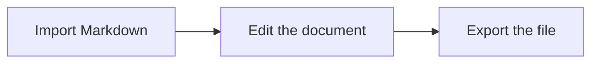

# Getting started

Click a paragraph to edit it, or type `/` to find an editing tool. Use the document outline to jump between sections. This is an ordinary Markdown file, so you can change it, rename it, or export a copy.

## Editor controls

| Action | Shortcut |
| :--- | :--- |
| Open the editing tools menu | `/` |
| Switch between editing and source | Ctrl+/ |
| Insert a table | Ctrl+Alt+T |
| Show or hide the file manager | Ctrl+Alt+F |
| Quickly open a file | Ctrl+P |
| Show or hide the document outline | Ctrl+Alt+O |
| Edit in fullscreen | Alt+Enter |
| Undo or redo | Ctrl+Z / Ctrl+Y |
| Exit fullscreen | Esc |

Move the pointer to the top edge or tap it on a touch screen to show the toolbar. Use the source icon to see how this file is written, or press Alt+Enter in the editor to write in fullscreen.

## Text and links

Try **bold**, *italic*, ~~strikethrough~~, and `inline code`. Use [an internal link](#math-and-diagrams) to jump to the math section, or open the [project repository][project].

> A blockquote can hold a note, a quotation, or a decision from a meeting.

---

## Lists and checkboxes

- Plan the document.
  - Add headings for the main ideas.
  - Use the outline to move between them.
- Write the first draft.

1. Edit a paragraph.
2. Check the result in source view.
3. Export the finished file.

- [ ] Try checking off a task.
- [ ] Import your own Markdown file.
- [x] Open the example.

## Tables

| Section | Status | Items |
| :--- | :---: | ---: |
| Outline | Done | 3 |
| First draft | In progress | 2 |
| Review | Pending | 1 |

Click a cell to edit it. Tab moves to the next cell, and Shift+Tab moves back. Use the table toolbar to resize the table, align columns, or insert and move rows.

## Code and YAML

```javascript
const topics = ["Markdown", "YAML", "Mermaid"]

for (const topic of topics) {
  console.log(topic)
}
```

Click inside the code block to try automatic indentation, change the language, or copy the code.

YAML front matter goes at the very top of a Markdown file, between two `---` lines. The YAML front matter command in the `/` menu adds `name` and `description` fields to documents such as `SKILL.md`.

```yaml
---
name: markdown-quickstart
description: A hands-on guide to the Markdown editor.
---
```

## Math and diagrams

Inline math like $a^2 + b^2 = c^2$ fits inside a paragraph. Use a display block for a formula on its own line.

$$
\sum_{k=1}^{n} k = \frac{n(n+1)}{2}
$$



The source toggle beneath the diagram reveals the Mermaid syntax.

## Images and footnotes

Use the image command in the `/` menu, paste an image, or drag a PNG, JPEG, GIF, WebP, or AVIF file into the editor. Markdown image syntax begins with `!` and includes a description for readers.

```markdown

```

Use a footnote to keep supporting details out of the main paragraph.[^storage]

[^storage]: The online editor saves files in the current browser. Export a Markdown copy to keep it elsewhere.

[project]: https://github.com/Lition13/markdown-editor
